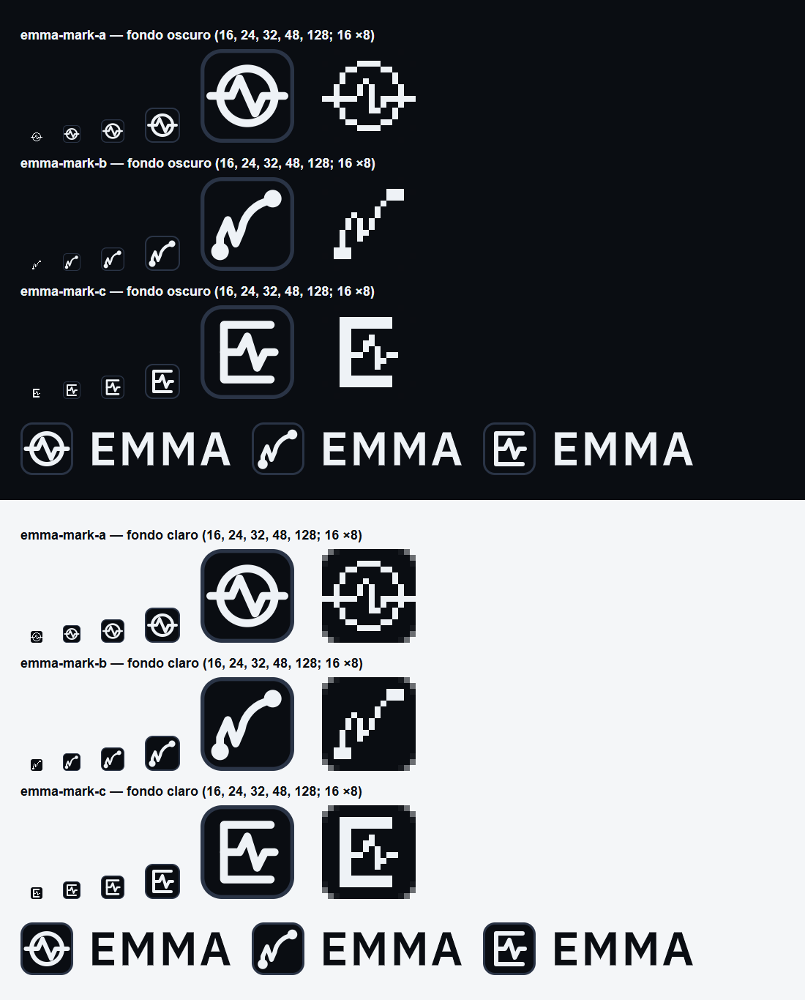

# Marca de EMMA — borrador

**Esto es un borrador para que el equipo lo apruebe o lo sustituya** (pedido por Ellande el
2026-11-04: «Propón un borrador»). Hasta ahora el instalador de Windows llevaba el icono por
defecto de Electron, y el vídeo de la entrega acaba en el logotipo (`docs/entrega/guion-video.md`).
Hay tres candidatas; la C es la recomendada y es la única que ya está conectada al instalador.



`hoja-de-contactos.png` enseña cada candidata a 16, 24, 32, 48 y 128 px, y el de 16 px ampliado
×8 sin suavizar, sobre el fondo oscuro de la aplicación y sobre uno claro, con sus logotipos.

## Las candidatas

| | Marca | Idea | A 16 px |
|---|---|---|---|
| A | `emma-mark-a.svg` | **Planeta con pulso**: un anillo (el planeta) cruzado por el trazo de un latido. | Se lee, pero el latido y el anillo se tocan; de lejos recuerda a una señal de «prohibido». |
| B | `emma-mark-b.svg` | **Pulso en órbita**: el latido sale de la Tierra (punto abajo a la izquierda) y se convierte en el arco del retardo de luz hasta la nave (punto arriba a la derecha). | Nítida, pero sin la leyenda no se entiende: parece una varita o una gráfica. |
| C | `emma-mark-c.svg` | **E de pulso**: la inicial, con el trazo central convertido en un latido. | La E se reconoce siempre y el latido se distingue. |

Cada marca tiene una versión dibujada píxel a píxel para 16 px (`emma-mark-<x>-16.svg`): a ese
tamaño un trazo en diagonal se convierte en una mancha gris, así que la E son barras de 2 px
sobre píxel entero y el latido, píxeles sueltos con una fila libre por encima y por debajo. Sin
ella, ninguna de las tres se leía bien en la barra de tareas.

Logotipos (marca + «EMMA»): `emma-logo-<x>.svg` para fondo oscuro y `emma-logo-<x>-claro.svg`
para fondo claro.

## Recomendación: la C

- **Es la que mejor aguanta a 16 px**, que es donde vive un icono de Windows: barra de tareas,
  explorador, Alt+Tab. La A se empasta y la B no dice nada sin explicación.
- **Nombra el producto**: la E se asocia a EMMA sin necesidad de texto al lado, y el latido dice
  «salud» sin recurrir a una cruz ni a un corazón, que en un contexto clínico suenan a servicio
  médico o a urgencia.
- **No promete más de lo que hace.** Una E con un latido es «esto mira constantes»; no hay cruz
  médica ni nada que sugiera prescripción (invariante 7) ni una insignia que sugiera respaldo de
  una agencia.
- El retardo de luz, que es lo que sostiene la autonomía del sistema, queda mejor contado en la
  B; si el equipo prefiere ese mensaje a la legibilidad, la B es la alternativa.

## Colores

Solo tres tokens de `frontend/src/lib/palette.ts`, todos **sin significado de señal**:

| Uso | Token | Valor |
|---|---|---|
| Fondo de la loseta | `bg` | `#0A0D12` (el mismo que la aplicación y que `backgroundColor` en `main.cjs`) |
| Borde de la loseta (no en 16 px) | `line` | `#2A3446` |
| Dibujo y texto del logotipo oscuro | `text` | `#EEF2F6` |
| Texto del logotipo claro | `bg` | `#0A0D12` |

A propósito no hay acento de color: en la paleta cada color con tono tiene significado fijo
(tabla F.5-1/F.5-2 de NASA-STD-3001: rojo y amarillo son alertas, azul aviso, cian dato caducado,
gris no disponible, magenta recomendación, verde foco y mando). Un icono en cualquiera de ellos
enseñaría ese significado en cada arranque. Blanco sobre la loseta oscura no dice nada.

Estilo: el de los pictogramas de `frontend/src/icons/` (rejilla de 24, trazo de 2, extremos y
uniones redondeados, pocas líneas, huecos de al menos dos unidades).

## Tipografía

«EMMA» va en **IBM Plex Sans SemiBold (600)**, la misma familia de la interfaz
(`@fontsource/ibm-plex-sans`), **convertida a contornos**: los logotipos no llevan `<text>` y no
necesitan la fuente instalada. IBM Plex se distribuye con la SIL Open Font License 1.1, que
permite usarla en obras como esta; no se redistribuye la fuente.

## Tamaños

- `png/emma-mark-<x>-<n>.png` en 16, 24, 32, 48, 64, 128, 256 y 1024 px, con transparencia en
  las esquinas. El de 16 sale de `emma-mark-<x>-16.svg`; los demás, del SVG de 24.
- `../icon.ico`: 16, 24, 32, 48, 64, 128 (BMP de 32 bits) y 256 px (PNG), cada tamaño
  rasterizado por separado, no reducido del grande. Sale de la candidata C.

## Dónde se usa

- `desktop/package.json` → `build.win.icon`, `build.nsis.installerIcon` y
  `build.nsis.uninstallerIcon` apuntan a `build/icon.ico` (claves comprobadas contra
  `app-builder-lib/scheme.json` de electron-builder 26.15.3). `installerHeaderIcon` no se pone:
  solo vale para el instalador de un clic, y el nuestro no lo es.
- `desktop/main.cjs` → `icon` de la ventana, para que `npm start` no lleve el de Electron; por eso
  `build/icon.ico` está también en `build.files`. Empaquetado, Windows ya lo toma del `.exe`.

## Cómo se regenera

Las fuentes de verdad son los SVG de esta carpeta, escritos a mano. Todo lo demás (PNG, hoja de
contactos, logotipos, `icon.ico`) lo hace `desktop/scripts/brand.py`, en local: Chromium de
Playwright rasteriza y Pillow lee los PNG; nada de conversores en línea. **No es una dependencia
de EMMA**: no se instala en ninguno de los cuatro entornos de Python; se usa uno desechable.

```bash
python -m venv %TEMP%\emma-brand
%TEMP%\emma-brand\Scripts\python.exe -m pip install playwright pillow fonttools
%TEMP%\emma-brand\Scripts\python.exe -m playwright install chromium
%TEMP%\emma-brand\Scripts\python.exe -I -X utf8 desktop/scripts/brand.py ^
    --font frontend/node_modules/@fontsource/ibm-plex-sans/files/ibm-plex-sans-latin-600-normal.woff
```

- Sin `--font` no se tocan los logotipos (solo hace falta para rehacerlos; fontTools no lee
  `.woff2` sin brotli, por eso el `.woff`).
- `--icon a` o `--icon b` hace el `.ico` con otra candidata, si el equipo elige otra.
- Para cambiar el dibujo, se edita el SVG de 24 **y** el de 16, y se vuelve a correr.

## Licencia

Igual que el repositorio: **AGPL-3.0-or-later** (`LICENSE`). Hecho para EMMA desde cero: ni arte
de terceros, ni imágenes de archivo, ni logotipos o insignias de la NASA ni nada que se les
parezca (no se sugiere ningún respaldo).

**Cómo se hizo, para `docs/entrega/uso-de-ia.md` (punto 4):** el borrador lo escribió el asistente
de programación (Claude Code) como SVG a mano —coordenadas en el código, sin generador de
imágenes— y se revisó mirando la hoja de contactos. Si el equipo lo adopta, hay que declararlo
ahí.
