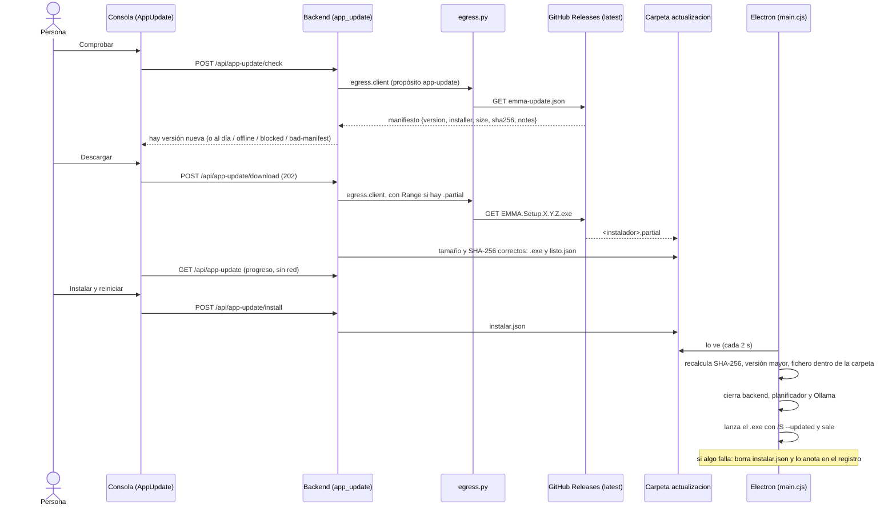

# Actualizaciones de EMMA

Cómo pasa el EMMA instalado (el instalador de Windows, `EMMA.Setup.X.Y.Z.exe`) a una versión nueva
publicada en `github.com/Brillande/EMMA/releases`, y cómo se publica una versión para que la vea.

La especificación normativa —requisitos, riesgos y controles— está en
[`compliance/software-update.md`](../compliance/software-update.md). Este documento es la guía de
uso y la explicación de la tecnología; si chocan, manda la especificación.

Lo que no se negocia, en una línea cada cosa:

- **Nunca automática.** EMMA no busca versiones por su cuenta: se comprueba con un botón y se
  instala solo cuando una persona pulsa «Instalar y reiniciar» (decisión del usuario, 2026-11-16).
- **Sale por la puerta.** Toda consulta y descarga pasa por `backend/app/core/egress.py`
  (invariante 3 bis), con el propósito `app-update`. Sin red, con el modo seguro o con el freno de
  Polaris no sale nada. Con el modo seguro, además, no se instala lo ya descargado.
- **Doble comprobación.** El backend comprueba el SHA-256 y el tamaño del instalador contra el
  manifiesto; la aplicación de escritorio vuelve a calcular el SHA-256 justo antes de lanzarlo.
- **Sin dependencias nuevas.** Ni `electron-updater` ni ninguna otra (ver [Por qué no
  electron-updater](#por-qué-no-electron-updater)).
- **No toca datos de salud.** No es una vía de ingesta: no escribe en el ledger ni en el almacén.

---

## Parte A. Para quien usa el programa

### Dónde está

En el pie de la consola, en «Acerca de EMMA», junto al panel «Modelos de IA», está el panel
**«Actualizaciones»** («Updates» con la interfaz en inglés). Enseña la versión instalada y, si se
ha comprobado, la última publicada.

Si la versión instalada sale como **«versión desconocida»**, el backend no ha recibido el número
de la aplicación de escritorio (pasa al arrancar el backend a mano, en desarrollo). Se puede
comprobar igual, pero no se ofrecerá instalar nada: sin saber qué hay instalado no se puede saber
si lo publicado es más nuevo.

### Qué significa cada estado

| Lo que se ve | Qué pasa | Qué hacer |
|---|---|---|
| Sin comprobar | Aún nadie ha pulsado «Comprobar». EMMA no consulta nada por su cuenta | Pulsar «Comprobar» si hay red y se quiere saber |
| Al día | La última versión publicada es la instalada (o una anterior) | Nada |
| Hay una versión nueva | Se ve su número, su tamaño y sus notas | «Descargar», si se quiere |
| Descargando | Barra de progreso. Se puede cancelar; lo bajado se guarda y la descarga sigue por donde iba la próxima vez | Esperar o cancelar |
| Lista para instalar | El instalador está bajado y su huella SHA-256 coincide con la publicada | «Instalar y reiniciar» cuando convenga |
| Instalando | EMMA se cierra, se instala la versión nueva y se vuelve a abrir | Esperar |

Cuando algo sale mal, el panel lo dice con uno de estos motivos (el código entre paréntesis es el
que devuelve la API y el que queda en los registros):

| Motivo | Qué significa |
|---|---|
| Sin red (`offline`) | EMMA está en modo sin red (`EMMA_OFFLINE`). No es un fallo: es el modo nominal de misión |
| Bloqueado (`blocked`) | La puerta de salida no deja pasar la petición: modo seguro, freno de Polaris o un host fuera de la lista blanca |
| Manifiesto no válido (`bad-manifest`) | Lo publicado no tiene la forma esperada (`emma-update.json` ausente, mal formado o de otra versión del esquema). No se descarga nada |
| Huella distinta (`bad-hash`) | El fichero bajado no es el que dice el manifiesto. Se borra y no se instala |
| Sin espacio (`no-space`) | No cabe el instalador en el disco del usuario |
| No está listo (`not-ready`) | Se pidió instalar sin un instalador bajado y comprobado |
| Modo seguro (`safe-mode`) | Se pidió instalar con el modo seguro activo. No se instala hasta desactivarlo; el instalador bajado se conserva |
| Misma versión (`same-version`) | Lo publicado no es más nuevo que lo instalado; no hay nada que instalar |

### Sin red

En modo sin red (`EMMA_OFFLINE=true`, el modo nominal de una misión) el panel lo dice y no falla:
enseña la versión instalada y explica que comprobar necesita red. No sale ninguna petición, ni
siquiera al pulsar el botón. Si ya había un instalador bajado y comprobado, sigue ahí y se puede
instalar sin red, porque instalar no sale a internet.

### Los datos se conservan

La versión nueva se instala encima de la anterior, en la misma carpeta. Lo que EMMA guarda fuera de
la carpeta de instalación no se toca:

- la carpeta de usuario de la aplicación (`%APPDATA%\EMMA`): caché, registros, datos del
  planificador y la propia carpeta de la actualización (`actualizacion`);
- el paquete de modelos (`%LOCALAPPDATA%\EMMA-modelos`), que no hay que volver a bajar.

El instalador de electron-builder, cuando encuentra una instalación, quita la versión anterior
conservando sus datos antes de copiar la nueva; EMMA además lo lanza con `--updated`, el
parámetro con el que electron-builder marca que se trata de una actualización. **Ojo:**
desinstalar EMMA a mano, desde Windows, **sí**
borra la carpeta de usuario (`deleteAppDataOnUninstall` en `desktop/package.json`). Para
actualizar o volver atrás no hay que desinstalar nada.

### Cómo volver a la versión anterior

EMMA no instala nunca una versión más antigua por sí misma: solo ofrece versiones mayores. Para
volver atrás, a mano:

1. Hacer una copia de `%APPDATA%\EMMA`. Una versión anterior podría no entender algo que haya
   escrito la nueva; con la copia se puede deshacer.
2. Bajar el instalador de la versión que se quiere (`EMMA.Setup.X.Y.Z.exe`) de su página en
   `github.com/Brillande/EMMA/releases`, junto con su `emma-update.json`.
3. Comprobar su huella antes de ejecutarlo y compararla con el campo `sha256` del manifiesto:
   `Get-FileHash .\EMMA.Setup.X.Y.Z.exe -Algorithm SHA256` (PowerShell). Las versiones publicadas
   antes de que existiera este mecanismo no traen manifiesto.
4. Cerrar EMMA y ejecutar ese instalador **sin desinstalar antes** la versión actual.

---

## Parte B. Para quien publica una versión

Para que un EMMA instalado vea una versión nueva hace falta una versión de GitHub marcada como
**latest** que lleve dos ficheros: el instalador y su manifiesto `emma-update.json`. EMMA pide
siempre `https://github.com/Brillande/EMMA/releases/latest/download/emma-update.json`
(`settings.update_url`, configurable con `EMMA_UPDATE_URL`). La versión `modelos-1` del paquete de
modelos no es *latest* y no debe serlo nunca.

El manifiesto:

```json
{
  "schema": 1,
  "version": "0.1.5",
  "installer": "EMMA.Setup.0.1.5.exe",
  "size": 123456789,
  "sha256": "<64 cifras hexadecimales>",
  "notes": "<texto>"
}
```

Paso a paso:

### 1. Subir el número en los cuatro sitios

El mismo `X.Y.Z` en:

- `backend/pyproject.toml` (`version`),
- `frontend/package.json` (`version`),
- `desktop/package.json` (`version`; es el que lee `app.getVersion()` y el que lleva el nombre
  del instalador),
- `backend/app/main.py` (`version=` de la aplicación FastAPI).

Una prueba de la suite falla si los cuatro no coinciden. El número tiene que ser **mayor** que el
de la última versión publicada: EMMA compara `X.Y.Z` como números (`0.1.10` es mayor que `0.1.9`)
y no ofrece nada que no lo sea.

### 2. Construir el instalador

```bash
cd desktop
npm run dist
```

`npm run dist` compila el frontend, congela el backend (`desktop/scripts/build-backend.mjs` llama a
`backend/packaging/freeze.py`, que lo hace desde un venv limpio, **nunca** desde `.venv`: con
pytest presente el empaquetado falla y lo entregado no debe llevar herramientas de prueba), compila
el planificador y genera el instalador NSIS en `desktop/release/` (`EMMA Setup X.Y.Z.exe`; GitHub
cambia los espacios por puntos al subirlo, de ahí `EMMA.Setup.X.Y.Z.exe`).

### 3. Probar el instalado

Instalar ese `.exe` en Windows y usarlo de verdad: arranca, el backend responde, la consola carga y
el panel «Actualizaciones» enseña `X.Y.Z` como versión instalada. Lo que no se ha probado
instalado no se publica.

### 4. Rehacer la foto pública

El repositorio de trabajo es solo local: no tiene remoto y su gancho `pre-push` rechaza cualquier
subida. Lo público vive en un repositorio aparte de publicación, una carpeta con su propio git y el
remoto `Brillande/EMMA`, que es una foto sin historia:

1. vaciarla (salvo `.git`) y volcar la rama que se publica con `git archive <rama> | tar -x`;
2. conservar el `.gitattributes` (la línea de Git LFS) y el `README.md` publicados;
3. hacer un commit con el correo *noreply* de GitHub y subirlo desde **esa** carpeta.

Hacerlo es decisión del usuario, cada vez.

### 5. Publicar la versión

```bash
python backend/packaging/publish_app.py
```

Lo ejecuta solo el usuario (necesita `gh` con sesión); nada de EMMA ni de sus pruebas lo lanza.
El script:

1. toma el instalador de `desktop/release/` y calcula su SHA-256 y su tamaño;
2. escribe `emma-update.json` con la versión, el nombre publicado del instalador, el tamaño, la
   huella y las notas;
3. crea la versión `vX.Y.Z` como borrador;
4. sube el instalador y el manifiesto;
5. la publica marcada como `--latest`.

El manifiesto se sube después del instalador y la versión solo se hace pública al final: mientras
tanto, `latest` sigue siendo la anterior y ningún EMMA ve una versión a medias.

### 6. Comprobar desde una instalación anterior

En un equipo con la versión anterior instalada (y con red): «Acerca de EMMA» → «Actualizaciones» →
«Comprobar». Tiene que aparecer `X.Y.Z` con sus notas; «Descargar» tiene que llegar a «Lista para
instalar», y «Instalar y reiniciar» tiene que dejar EMMA abierto en `X.Y.Z`, con los datos de
antes. Si algo falla, el motivo está en el panel y en `%APPDATA%\EMMA\logs`.

---

## Cómo funciona

Las piezas, que copian el patrón de «Modelos de IA» (`backend/app/models_download.py`,
`backend/app/api/models_pack.py`, `frontend/src/components/ModelsPack.tsx`):

- **Backend** (`backend/app/app_update.py`): lee el manifiesto, compara versiones y baja el
  instalador por `egress.client` con el propósito `app-update` (hosts permitidos: `github.com`,
  `objects.githubusercontent.com` y `release-assets.githubusercontent.com`, por las redirecciones
  de GitHub a sus servidores de ficheros). Reanuda con `Range` y comprueba tamaño y SHA-256.
- **API** (prefijo `/api/app-update`): `GET /api/app-update` da el estado sin salir a la red;
  `POST /api/app-update/check`, `/download` (responde 202 y baja en segundo plano), `/cancel` e
  `/install` (solo si hay `listo.json`). Los `POST` exigen la cabecera de consola
  (`X-EMMA-Console: 1`).
- **Carpeta** (`settings.update_dir`, `EMMA_UPDATE_DIR`; la aplicación de escritorio la pone en
  `%APPDATA%\EMMA\actualizacion`): `<instalador>.partial` mientras baja, el `.exe` comprobado,
  `listo.json` (`{version, file, sha256, size}`) cuando está listo e `instalar.json`
  (`{version, file, sha256, requested_at}`) cuando alguien pide instalar.
- **Versión actual**: `settings.app_version` (`EMMA_APP_VERSION`), que `desktop/main.cjs` pasa al
  backend con `app.getVersion()`.
- **Escritorio** (`desktop/main.cjs`): mira `instalar.json` cada 2 s. Cuando aparece, vuelve a
  calcular el SHA-256 del instalador, exige que la versión sea mayor que la suya y que el fichero
  esté dentro de la carpeta de actualización; cierra el backend, el planificador y Ollama, lanza
  el instalador con `/S --updated` y sale. Si alguna comprobación falla, borra `instalar.json`, lo
  anota en el registro y no instala nada.
- **Interfaz** (`frontend/src/components/AppUpdate.tsx`): el panel del pie.



### Por qué no electron-updater

`electron-updater` es lo habitual para actualizar una aplicación de Electron, y se descartó:

- **Saldría a internet desde Node**, desde la aplicación de escritorio, y se saltaría
  `backend/app/core/egress.py`. Eso rompe la invariante 3 bis: la lista blanca por propósito, el
  modo sin red, el modo seguro, el freno de Polaris y la traza de lo que sale tienen que estar en
  un solo sitio, y una vía paralela de salida es justo lo que esa puerta existe para impedir.
- **Sería una dependencia nueva** que comprobar, versionar y declarar (la ficha de SOUP), para
  algo que EMMA ya sabía hacer: «Modelos de IA» ya baja ficheros grandes de las versiones de
  GitHub, los reanuda, comprueba su huella y lo enseña en la consola.
- **Busca y baja sola** por defecto, y aquí se decidió que no: la comprobación es solo con botón y
  la instalación solo cuando una persona lo pide.

Lo que hace Electron se queda en lo que solo puede hacer él: comprobar otra vez el fichero justo
antes de ejecutarlo, cerrar lo que tiene abierto y lanzar el instalador.

### Alcance

Este mecanismo garantiza que lo que se instala es el fichero que se publicó, con la huella que se
publicó, y que nadie instala nada sin pedirlo. **No** garantiza quién lo publicó: el instalador no
lleva firma de código y la huella viaja en el mismo sitio que el fichero, así que quien pudiera
cambiar la versión publicada podría cambiar las dos cosas. Los riesgos y controles están en
`compliance/software-update.md`.
