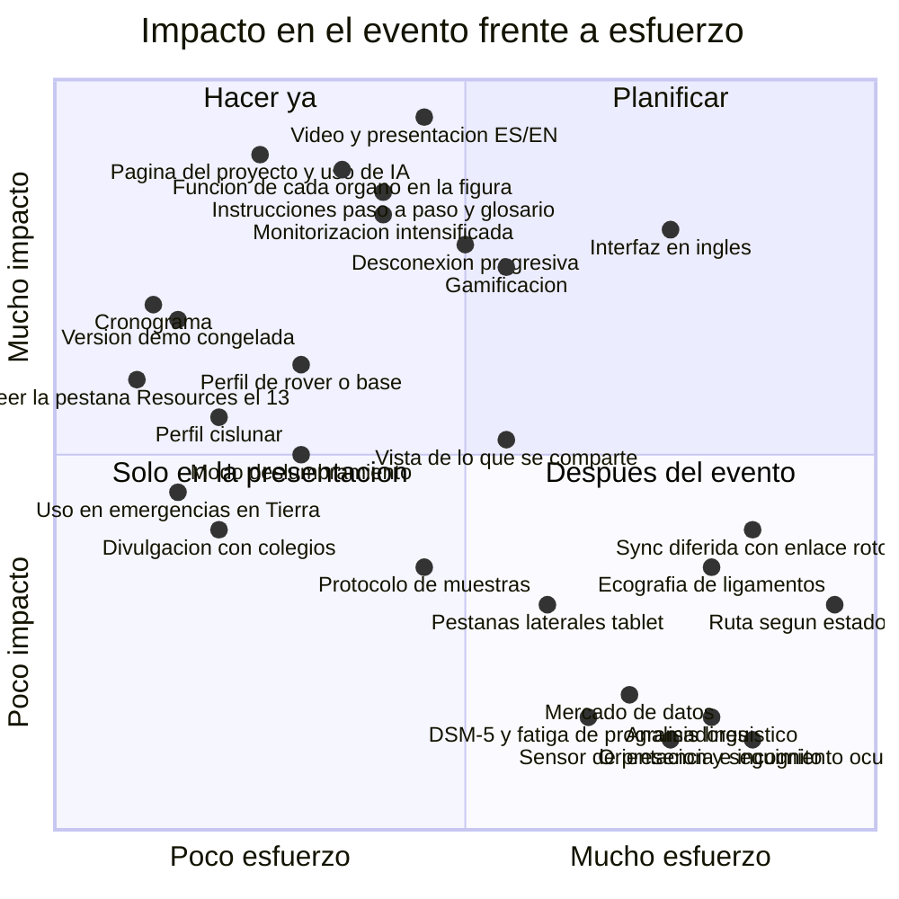

# Prioridades para el evento (2026-11-02)

Fuente: 14 notas de voz distintas del equipo del 2026-11-02, de las 19.19.54 a las 19.50.04,
transcritas en local con Whisper `base` y cruzadas con
`docs/contexto/README.md` y el código. Evento: **14 y 15 de noviembre de 2026**
(`compliance/challenge-coverage.md` §4). Quedan 12 días.

Impacto = lo que cambia ante el jurado el día del evento. Esfuerzo = trabajo hasta entonces.

**Decisión del equipo (2026-11-02):** la regla «no empezar antes del hackathon»
(`challenge-coverage.md` §4) se deja fuera de esta priorización.

**Lo que queda del contexto, además de los audios:** el enunciado del reto tiene una fila «no»
y siete «en parte» (`compliance/challenge-coverage.md` §2 y §6). Lo que pide expresamente, y el
jurado puede buscar, es:
- texto sobre la función de cada órgano en la figura humana clicable;
- instrucciones paso a paso para medirse, y un glosario;
- gamificación (la única fila «no»): la animación y el color llevan significados de F.5-1 y no
  pueden ser recompensa, así que tendría que ir por otra vía (rachas de medidas al día, por ejemplo);
- un perfil de róver o de base planetaria.

El «Pendiente» de `docs/contexto/README.md` es casi todo lectura de fuentes (campos sin verificar,
coste de medir) y decisiones finas de diseño, que no se ven el día del evento.

## 1. Hacer ya (bloquea la entrega o es lo que más se ve)

| # audio | Qué | Estado hoy | Por qué ahora |
|---|---|---|---|
| reto | **Función de cada órgano en la figura** | Parcial: la figura y la cadena existen; el texto de función no | El enunciado lo pone como ejemplo de interfaz. Texto con fuente, sin inventar. |
| reto | **Instrucciones paso a paso y glosario** | Parcial: ventanas y signos de la ecografía | El enunciado: «no supongas que el astronauta sabe evaluarse». |
| reto | **Gamificación** | No | Es la única fila «no» del enunciado. Sin usar color ni animación como premio. |
| 6, 18 | **Vídeo y presentación, en castellano y en inglés** | Falta | Es lo que el jurado ve primero. Sin exagerar (invariante 6). |
| 12 | **Página del proyecto y descripción del uso de IA** | Falta | La entrega exige describir cómo se usó la IA. Texto nuevo, no pegado de un chat. |
| 12 | **Cronograma día a día hasta el 15** | Falta | Barato y ordena todo lo demás, también el gasto de tokens. |
| 11 | **Versión de demo congelada** (etiqueta git local `demo-v1`) | Falta | El instalador EMMA ya existe; etiquetarlo y enseñar a los mentores solo esa versión. |
| 20 | **Protocolo de monitorización intensificada ante un evento** | Parcial: refugio por SEP (`analysis/radiation.py`), rutinas (`routines.py`) | Falta subir la frecuencia y priorizar parámetros al dispararse. Se apoya en lo que ya hay y luce en la demo con DONKI. |
| 2 | **Desconexión progresiva** (qué es lo mínimo con poca energía o tripulación) | Parcial: modo seguro, fail-closed, HALT | Con el 20 forma unos «modos de misión»: una historia clara para el jurado. |

## 2. Planificar (impacto alto, cuesta más)

- **Interfaz en inglés (9):** hoy todo está en castellano (`names_es.py`, `lang="es"`), y el jurado
  es internacional. Como mínimo, la demo en inglés. La interfaz no redacta texto clínico: hay que
  traducirlo en el backend.

## 3. Mejoras baratas y vistosas, si sobra tiempo

- **13 de noviembre: leer la pestaña «Resources» del reto** y ver su vídeo (`challenge-coverage.md` §6).
- **Perfil de róver o de base (reto),** junto al cislunar.
- **Perfil cislunar (1):** hay LEO, Luna y Marte (`evidence/mission_profiles.py`), pero no
  cislunar, que es el de Artemis/Gateway.
- **Modo deslumbramiento/alto contraste (9):** siempre dentro de `palette.ts` (≥ 6:1, tabla F.5-1).
- **Vista de qué se comparte y qué no (14):** se apoya en `egress.py` y en el corte de Tierra.

## 4. Solo en la presentación, como visión de producto

- **Uso en Tierra (10):** emergencias, montaña, inundaciones. Ya es offline-first, así que una
  diapositiva basta.
- **Divulgación con colegios (21, audio de las 19.40.14):** actividades de ejercicio físico con
  colegios, en la línea de los programas de colaboración de la NASA con escuelas, para explicar
  por qué importan la exploración espacial y sus retos. Sale barato como diapositiva.
- **Ruta según el estado médico (4), mercado de datos (5), protocolo de muestras (19).** Ojo: la
  firma inmune desde OSD-288 está descartada, y OSD-288 son ratones.

## 5. Después del evento o descartado

- **Ecografía de ligamentos (13):** es la tarea pendiente de Ellande; no condiciona la demo.
- **Sincronización diferida con enlace roto (10)** y **pestañas laterales tipo tablet (1).** La 10
  se adelantó el 2026-11-05 a petición del ideograma del usuario (P3), en su versión mínima: un
  enlace simulado que una persona declara caído o restablecido. Detalle en `README.md`,
  «Sincronizar con el enlace roto».
- **DSM-5 (7):** choca con la invariante 7, porque el DSM es para diagnosticar. Igual que el
  **análisis lingüístico del estado mental (17):** sería Clase C y necesita validación. Tampoco se
  hace el subproducto para programadores.
- **Difuminado, orientación y seguimiento ocular (15)** y **sensor de presencia con modo
  incógnito (16):** necesitan hardware.
- **Descartado ya:** correlación externo-interno sobre datos simulados («circular») y blindaje por
  módulo (`README.md`, «No se adopta»).
